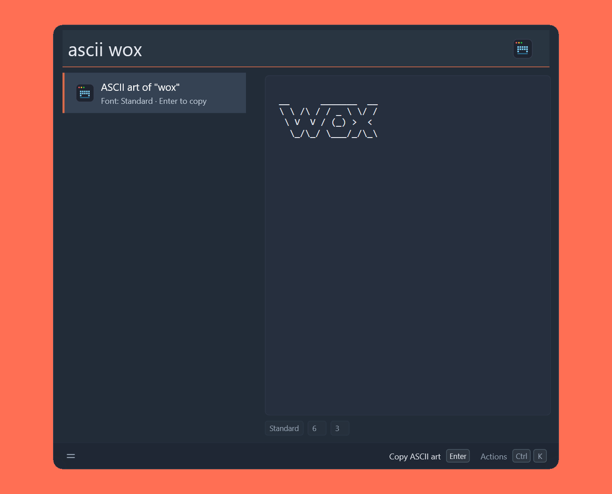
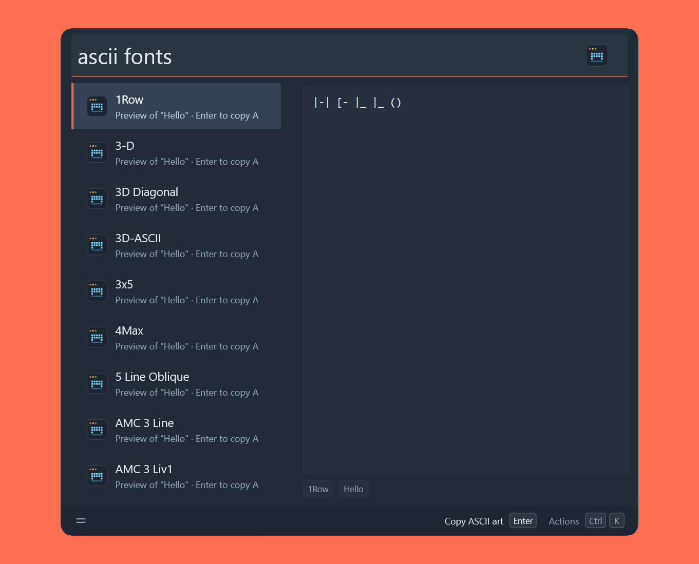
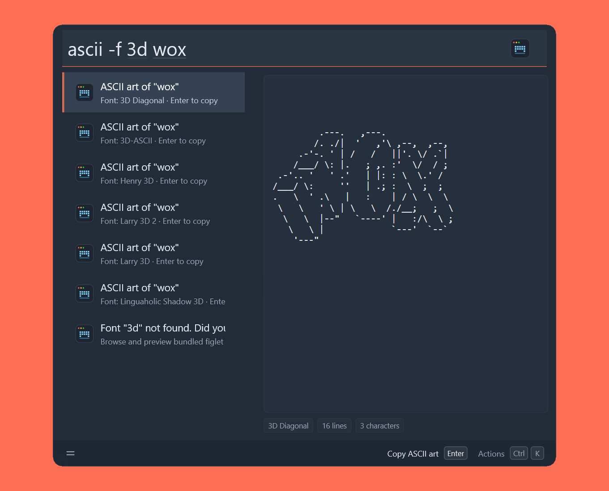

# ASCII Art Generator


A [Wox](https://www.woxlauncher.com/) plugin that turns plain text into **ASCII art** with [FIGlet](http://www.figlet.org/) fonts. Pick from more than 330 bundled fonts, preview the result in a real monospace panel, then copy it as text, as a PNG image, or as a ready-to-paste code snippet. Everything runs locally.

```text
     _    ____   ____ ___ ___      _         _
    / \  / ___| / ___|_ _|_ _|    / \   _ __| |_
   / _ \ \___ \| |    | | | |    / _ \ | '__| __|
  / ___ \ ___) | |___ | | | |   / ___ \| |  | |_
 /_/   \_\____/ \____|___|___| /_/   \_\_|   \__|
```

## Features

- **Instant rendering** — `ascii <text>` draws the text with the default font and shows it in a monospace preview that keeps every column aligned.
- **330+ bundled FIGlet fonts** — `ascii fonts` browses the fonts shipped with FIGlet, with a live preview of your text and type-to-filter.
- **Per-query font** — `ascii -f slant hello` renders with any font for one query, without touching the default. Font names are case-insensitive and may contain spaces.
- **Font suggestions** — a mistyped font name lists the closest matches and renders the text with each of them.
- **Copy and save** — copy the art to the clipboard, copy it as a PNG image, or save it as `.txt` / `.png` on the Desktop.
- **Copy as code** — an optional action that wraps the art in valid string literals or block formats for 74 languages and formats (Bash, PowerShell, Batch, Python, JavaScript, C/C++, Go, Rust, HTML, Markdown, JSON, YAML, …).
- **Theme aware** — the preview and the exported PNG use the active Wox palette, so light and dark themes both look right.
- **Localized** — English and Simplified Chinese, following the Wox language.
- **Offline** — no network access, no external services.

## Screenshots







## Install

```shell
wpm install ASCIIArtGenerator
```

## Usage

The trigger keyword is `ascii` by default. It can be renamed in the Wox plugin settings; every command below still works because the plugin parses the query itself.

### Render text

```shell
ascii Hello
```

Type the trigger keyword followed by the text to render. `Enter` copies the ASCII art. The result subtitle shows the font in use, and the preview pane renders the art with a monospace font stack, shrinking the font size (8–14 px) so wide art still fits.

### Render with a specific font

```shell
ascii -f slant Hello
ascii --font "Small Slant" Hello
ascii --font=Slant Hello
```

`-f` / `--font` takes the font name, and the rest of the line is the text. After typing `ascii -f `, Wox also offers Tab-navigable slots for the font name and the text, which is handy for multi-word fonts. The default font is unaffected; use the font list to change it permanently.

If the font does not exist, the result suggests the closest names and previews the text in each of them.

### Browse fonts

```shell
ascii fonts
ascii fonts sl
```

`ascii fonts` lists the matching fonts (up to 120 at a time) and previews each one with a sample text. When you arrive from **Try other fonts…**, the sample is the text you were rendering; typing the command directly previews `Hello`. Type after the command to filter by name. From the list you can copy an art, copy a font name, use a font for the next render, or set it as the default font.

Typing `ascii` with an empty query shows a short help entry list: generate text, list all fonts, and the current default font.

### Actions

Actions on a rendered result:

| Action                    | Description                                                                            |
| ------------------------- | -------------------------------------------------------------------------------------- |
| Copy ASCII art            | Copy the art to the clipboard (also the default `Enter` action)                        |
| Copy as image             | Copy the art as a PNG image, rendered at 2× for HiDPI displays                         |
| Copy as `<language>` code | Only shown when **Copy as code** is enabled; wraps the art for the configured language |
| Save to text file         | Write `<text>-<timestamp>.txt` to the Desktop                                          |
| Save PNG to desktop       | Write `<text>-<timestamp>.png` to the Desktop                                          |
| Try other fonts…          | Open the font list previewing the current text                                         |

Actions on a font-list entry:

| Action                              | Description                                                   |
| ----------------------------------- | ------------------------------------------------------------- |
| Copy ASCII art                      | Copy the previewed art                                        |
| Copy as image / Save PNG to desktop | Same as above, using the previewed text and font              |
| Use this font                       | Jump back to `-f <font> ` so you can type the text right away |
| Copy font name                      | Copy the exact font name                                      |
| Set as default font                 | Use this font whenever `-f` is not given                      |

Saved files fall back to the home directory when there is no `Desktop` folder.

### Settings

| Setting                | Default    | Description                                                                                                                                      |
| ---------------------- | ---------- | ------------------------------------------------------------------------------------------------------------------------------------------------ |
| Default font           | `Standard` | Font used when the query has no `-f`                                                                                                             |
| Copy as code           | Off        | Add a **Copy as `<language>` code** action to every result                                                                                       |
| Code language / format | `Bash`     | Language or format used by that action (74 entries, from shells and general-purpose languages to HTML, Markdown, JSON, YAML, Makefile, and NASM) |

## Requirements

- Wox >= 2.4.8
- Windows, Linux, or macOS
- The Node.js runtime, the FIGlet fonts, and the PNG rasterizer are bundled in the released package; nothing else needs to be installed

## Development

Requires Node.js, [pnpm](https://pnpm.io/), and `make`.

```shell
make install   # install dependencies
make lint      # eslint
make format    # prettier --write
make test      # run jest unit tests
make build     # bundle src/ into dist/
make package   # build and produce wox.plugin.asciiartgenerator.wox
make dev       # rebuild on change with nodemon
```

`make package` emits the installable `.wox` archive.

### Project structure

```text
plugin.json       manifest: trigger keyword, commands, settings, i18n strings
images/app.svg    plugin icon
src/index.ts      query parsing, results, actions, settings handling
src/preview.ts    monospace webview preview (HTML, theme colors, font fitting)
src/image.ts      PNG rendering with pureimage and the system font stack
src/snippets.ts   language registry behind "Copy as code"
src/__tests__/    jest tests
scripts/          project bootstrap helper
```

## Credits

- [figlet.js](https://github.com/patorjk/figlet.js) — FIGlet implementation and the bundled fonts
- [pureimage](https://github.com/joshmarinacci/node-pureimage) — PNG rendering for the copy/save image actions
- [@wox-launcher/wox-plugin](https://www.npmjs.com/package/@wox-launcher/wox-plugin) — Wox plugin SDK

## License

GPL-3.0 — see [LICENSE](LICENSE). Copyright (C) 2026 dragonish.
